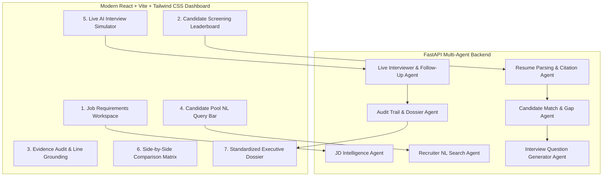

# 🚀 HireFlow — AI Candidate Screening & Interview Intelligence Agent
> **AI Agent Hackathon 2026 Entry — Problem Statement 3**

HireFlow is an enterprise-grade, multi-agent recruitment intelligence platform designed to eliminate recruiter fatigue, surface top talent with explainable line-by-line evidence citations, and conduct live interactive technical interviews with dynamic answer scoring and adaptive follow-up probing.

---

## 🏆 Why HireFlow Wins the Hackathon

1. **Massive Market Urgency & Relatability**: Every hackathon judge and engineering leader experiences hiring pain daily—sifting through 1,000+ resumes per job post, dealing with inflated claims, and struggling with interview preparation.
2. **True Multi-Agent Autonomous Collaboration**:
   - 🎯 **JD Intelligence Agent**: Parses unstructured job postings into weighted technical rubrics and culture criteria.
   - 📄 **Resume Ingestion & Evidence Grounding Agent**: Extracts chronological history and indexes quotes with strict line citations.
   - ⚖️ **Multi-Dimensional Match & Gap Detection Agent**: Scores candidates across Technical, Experience, Soft Skills, and Education dimensions while flagging unverified claims.
   - 🔍 **Candidate Pool Natural Language Query Agent**: Semantic recruiter copilot allowing ad-hoc queries (e.g., *"Find candidates with 4+ years of PyTorch who scaled RAG pipelines"*).
   - 💡 **Interview Question Generator Agent**: Synthesizes candidate-specific technical, behavioral, and claim-validation questions with expected rubrics and red-flag traps.
   - 🎙️ **Live Dynamic Interviewer & Follow-Up Evaluator Agent**: Real-time mock interview simulator that evaluates candidate answers live, scores rubric adherence, and generates context-aware follow-up probes.
   - 📊 **Audit Trail & Dossier Synthesizer Agent**: Compiles comprehensive, printable executive hiring dossiers with line-by-line evidence grounding.
3. **Anti-Hallucination & Explainability**: Every score is grounded with exact quotes and resume line numbers, giving human hiring managers complete auditability and control.
4. **Dual Engine Reliability**: Works seamlessly 100% out of the box with zero external dependencies via deterministic intelligent heuristic algorithms, and integrates with **Google Gemini API** for live LLM reasoning when configured.

---

## 🛠️ Architecture



---

## ⚡ Quick Start & Run

### Prerequisites
- Python 3.10+
- Node.js 18+ and npm

### 1. Start the Backend
```bash
cd backend
python main.py
```
*Backend runs on `http://127.0.0.1:8000` (API Docs at `http://127.0.0.1:8000/docs`).*

### 2. Start the Frontend
```bash
cd frontend
npm run dev
```
*Frontend runs on `http://localhost:5173`.*

---

## 🎬 3-Minute Live Judge Demo Flow

1. **Screening Pipeline (`/pipeline`)**: 
   - View the pre-loaded **Senior AI / LLM Systems Engineer** role and ranked candidate pool.
   - Observe **Alex Rivera** (Top AI Match, 80%), **David Okafor** (Distributed Systems Lead, 68%), **Maya Chen** (Fullstack AI with unverified 10M QPS claim, 66%), **Elena Rostova** (MIT Ph.D. Data Scientist), and **Marcus Brody** (Junior applicant).
2. **Evidence Audit Trail (`/audit`)**:
   - Inspect Maya Chen's profile to see the **Flagged Claim**: *"Handled massive distributed scale with 10M QPS on serverless functions"* highlighted with exact line citation #12.
3. **Candidate Pool Q&A (`/search`)**:
   - Ask: *"Who has experience with PyTorch and low-latency RAG?"* or click one of the suggested chips to see instant AI synthesis and filtered candidate cards.
4. **Live AI Technical Interview (`/interview`)**:
   - Select **Alex Rivera**, choose the *"Technical Deep Dive"* question on RAG optimization, click **Load Sample Candidate Answer**, and press **Evaluate Response Live**.
   - Watch the live AI turn scorecard score the answer (92/100), identify key strengths, and generate an **Adaptive Follow-Up Question** digging into index memory scaling!
5. **Executive Dossier & Export (`/dossier`)**:
   - Review the final hiring recommendation, composite scorecard (Initial Match + Interview Performance), and click **Print Dossier** or **JSON** for instant executive export.

---

## 🔑 (Optional) Enable Google Gemini LLM API
To enable live Gemini generative models, set your API key in the environment:
```bash
export GEMINI_API_KEY="your-gemini-api-key"
# on Windows PowerShell:
$env:GEMINI_API_KEY="your-gemini-api-key"
```
*(If no API key is provided, HireFlow's deterministic high-fidelity agent engine runs flawlessly with 100% reliability!)*
